


  

 

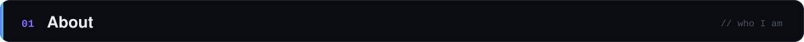

I'm a **Computer Science engineer** (B.E. CSE, CIT Coimbatore — 2026) who builds **AI agents and the verification that holds them accountable**.

- 🧪 **Handshake AI** — designed sandboxed, verifier-graded tasks that benchmark frontier AI coding agents
- 🏗️ **Zoho** — built an ASP.NET Core web app with security alerting, plus a C++ APM tool for IIS
- 🛡️ **Prodigy InfoTech** — vulnerability assessments and web-app penetration testing
- 📖 Off the clock I write fiction as **"Forgetful_sloth"**

 

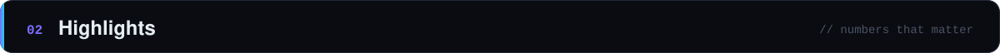

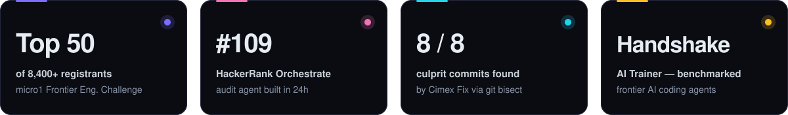

  

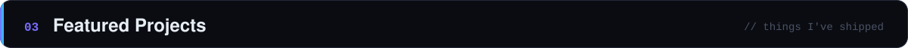

<a href="https://github.com/GegarinSagolsem/cimex-fix">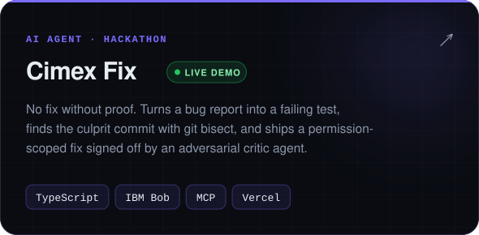</a>
<a href="https://github.com/GegarinSagolsem/ScreenTranslator">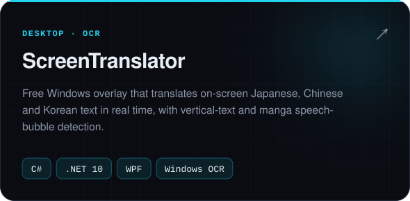</a>
<a href="https://github.com/GegarinSagolsem/Clash-Point">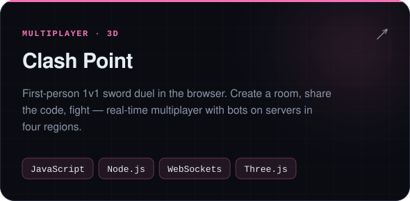</a>
<a href="https://github.com/GegarinSagolsem/Kaiden">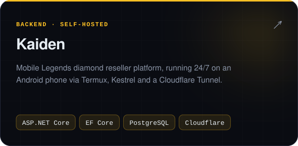</a>
<a href="https://one-manipur.vercel.app">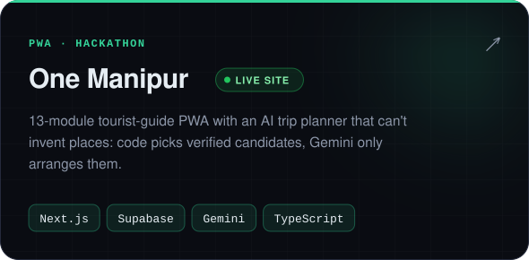</a>
<a href="https://github.com/GegarinSagolsem/claude-statusline">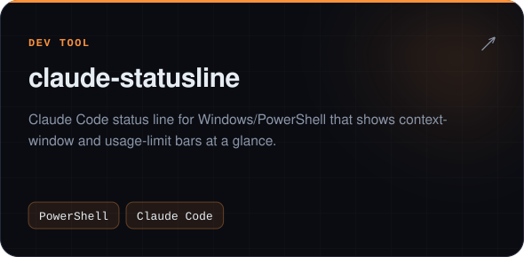</a>

 

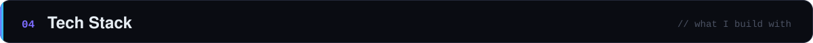

 

  

  

  

  
<b>Also:</b> MCP · Gemini API · IBM watsonx.ai · Entity Framework Core · WPF · .NET MAUI · Burp Suite · Nmap · Wireshark

 

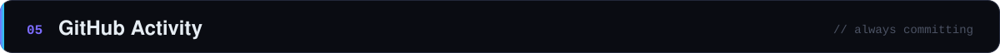

 

 

<a href="https://www.linkedin.com/in/gegarin-sagolsem-844a53318/">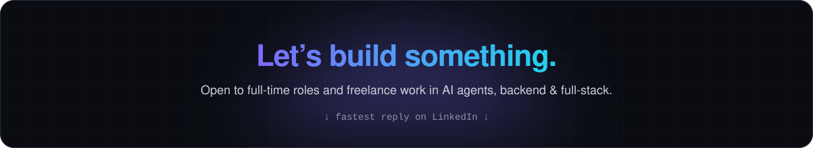</a>
